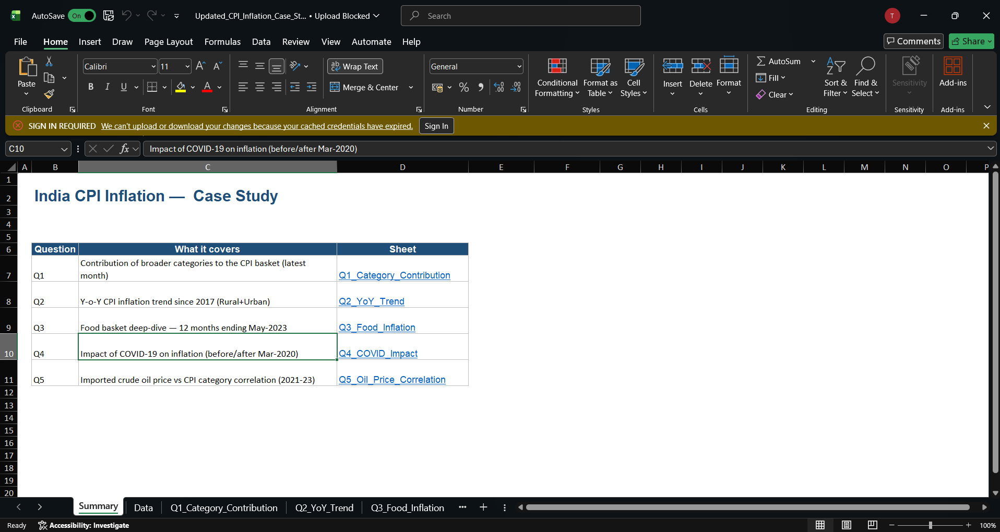

# India CPI Inflation Analysis (Excel)

Analysis of All India Consumer Price Index data (January 2013 to May 2023)
using formula-driven Excel with charts. Year-on-year inflation is analyzed
from 2017.

## Tools Used
- Excel (formulas, PivotTables, charts)

## Analysis Sheets
- Q1: Category contribution to the CPI basket
- Q2: Year-on-year inflation trend
- Q3: Food inflation (May 2022 to May 2023)
- Q4: Impact of COVID-19 on inflation
- Q5: Oil price vs CPI category correlation

## Key Findings
- Year-on-year inflation peaked at 7.79% in April 2022; 2022 had the
  highest annual average (6.62%).
- Average inflation rose from 4.08% to 5.79% comparing the two years
  before and after March 2020.
- Food basket (May 2022 to May 2023): index up 3.35%; Spices rose most
  (+17.9%), Cereals +12.7%, Oils & Fats fell 16%.
- Brent crude oil prices showed only weak correlation with CPI
  categories (highest 0.15).

## Files
- CPI_Inflation_Analysis.xlsx: the Excel workbook with all analysis
- All_India_Index_Upto_April23 (1) (3).csv: the CPI data
- cpi_summary.png: summary preview

## How to Open
Download the .xlsx file and open it in Excel.
